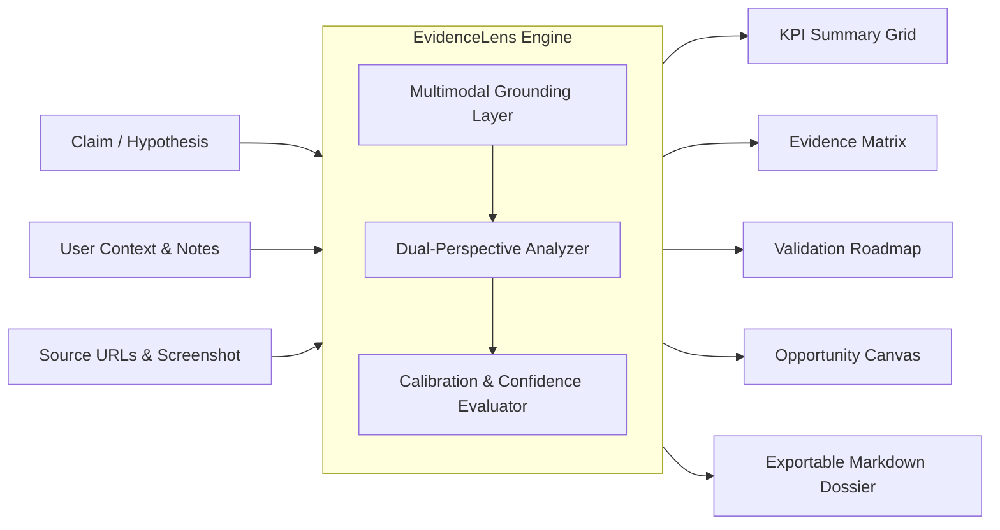

<div align="center">

# EvidenceLens

### Multimodal Claim Validation & Decision Brief Generator

[](https://python.org)
[](https://streamlit.io)
[](https://ai.google.dev/)
[](https://opensource.org/licenses/MIT)

<p align="center">
  <b>Transform any hypothesis, startup claim, or research thesis into a grounded, calibrated decision brief in seconds.</b>
</p>

[Overview](#-overview) • [Quickstart](#quickstart) • [Features](#key-features) • [Architecture](#architecture) • [Supported Models](#-supported-models) • [Project Structure](#-project-structure) • [Contributing](#-contributing) • [Author](#author)

</div>

---

## 📌 Overview

EvidenceLens is an autonomous research validation assistant engineered to eliminate confirmation bias and information overload. Rather than generating generic text summaries, EvidenceLens critically decomposes claims into empirical supporting evidence, quantifiable counter-arguments, unverified assumptions, and practical validation milestones.

Whether evaluating customer willingness-to-pay, stress-testing an academic paper, or analyzing an NGO pilot project, EvidenceLens separates verified evidence from uncertainty.

---

## Key Features

- **Calibrated Verdict & Confidence Scoring**: Categorizes claims into `Supported`, `Weakly Supported`, `Mixed`, `Unclear`, or `Refuted` with probability calibration.
- **Side-by-Side Evidence Matrix**: Strict separation of empirical supporting proofs from counter-arguments and risks.
- **Multimodal Visual Inspection**: Upload screenshots of academic figures, charts, survey tables, or field photos for native visual analysis alongside text.
- **Gap & Assumption Identification**: Explicitly identifies missing parameters, unverified assumptions, and citation blind spots.
- **Actionable Validation Roadmap**: Step-by-step milestones to test hypotheses through pilots, surveys, or primary-source interviews.
- **Venture Opportunity Canvas**: Translates hypotheses into an entrepreneurial blueprint covering target problems, beneficiaries, and recommended MVP prototypes.
- **Markdown Dossier Export**: Download complete research dossiers in clean Markdown format ready for grant proposals, pitch decks, or memos.

---

## Architecture



---

## Quickstart

### Prerequisites

- Python 3.10, 3.11, or 3.12
- Google AI Studio API key (optional for offline demo mode)

### 1. Clone the Repository

```bash
git clone https://github.com/<YOUR_USERNAME>/evidencelens.git
cd evidencelens
```

### 2. Set Up a Virtual Environment

**On Windows (PowerShell):**
```powershell
python -m venv .venv
.\.venv\Scripts\Activate.ps1
```

**On macOS / Linux:**
```bash
python3 -m venv .venv
source .venv/bin/activate
```

### 3. Install Dependencies

```bash
pip install -r requirements.txt
```

### 4. Configure Environment Variables

Copy the template configuration file:

```bash
cp .env.example .env
```

Open `.env` and insert your Gemini API key:

```ini
GEMINI_API_KEY=your_google_ai_studio_api_key_here
GEMINI_MODEL=gemini-2.5-flash
```

### 5. Launch the Application

```bash
streamlit run app.py
```

The application will be accessible at `http://localhost:8501`.

---

## ⚙️ Supported Models

EvidenceLens supports multiple Google GenAI engines selectable directly within the UI:

| Model | Primary Strengths | Recommended Use Case |
|---|---|---|
| **`gemini-2.5-flash`** | Sub-second latency, multimodal vision, native JSON output | Default for production research and live evaluation |
| **`gemini-2.5-pro`** | Extended reasoning depth, complex multi-variable analysis | Complex scientific literature and intricate policy analysis |
| **`gemma-4-31b-it`** | High-performance open-weights instruction model | Open-source workflows and edge deployments |
| **`gemini-flash-latest`** | Automatic alias tracking the latest production release | Continuous auto-updating deployments |

---

## 📂 Project Structure

```
evidencelens/
├── app.py                      # Core Streamlit application and analytics dashboard
├── requirements.txt            # Production dependencies
├── requirements-hackathon.txt  # Hackathon mirror requirements
├── .env.example                # Safe configuration template
├── .gitignore                  # Security-first ignore rules for credentials
├── LICENSE                     # MIT License
├── README.md                   # Project documentation
├── example_output.md           # Sample output brief
└── sample_output/              # Reference test outputs
```

---

## 🤝 Contributing

Contributions are welcome. Please open an issue or submit a pull request.

1. Fork the project
2. Create your feature branch (`git checkout -b feature/NewFeature`)
3. Commit your changes (`git commit -m 'Add NewFeature'`)
4. Push to the branch (`git push origin feature/NewFeature`)
5. Open a Pull Request

---

## Author

**Muhammad Tayyab**  

[](https://www.linkedin.com/in/muhammad-tayyab10/)

---

## License

Distributed under the MIT License. See [`LICENSE`](LICENSE) for details.
